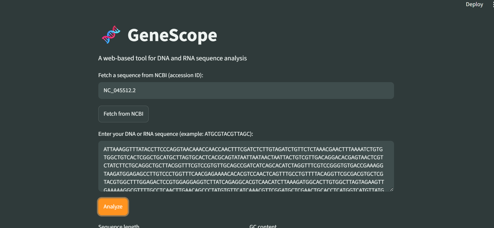
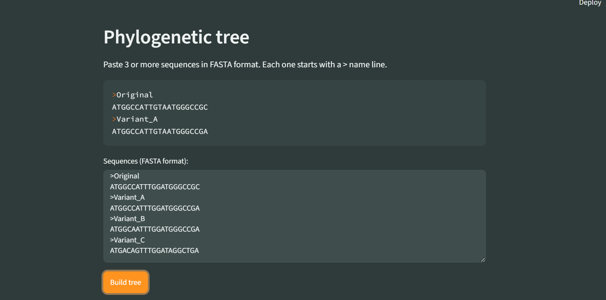
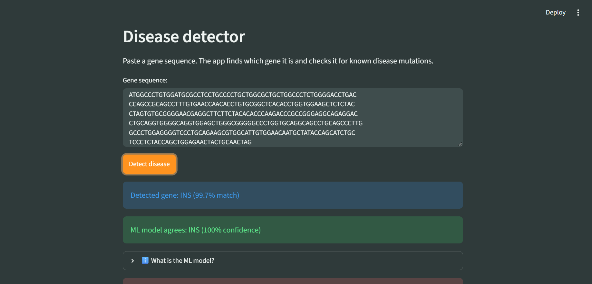
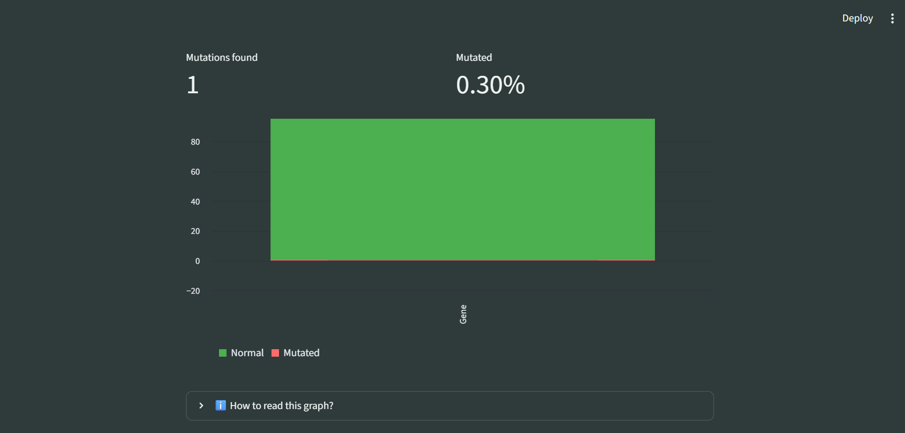
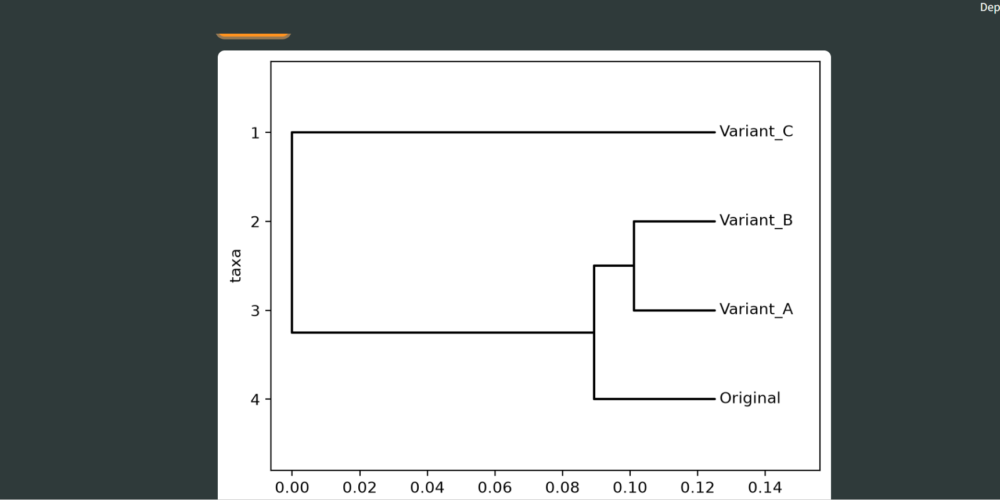

<div align="center">

# 🧬 GeneScope

**An interactive DNA/RNA sequence analysis and mutation-detection web app**


</div>

---

## 📌 Overview

GeneScope turns raw DNA/RNA sequences into meaningful biological insights. It supports sequence analysis, mutation detection, disease matching and phylogenetic comparison, and can fetch real sequences directly from NCBI, including the **SARS-CoV-2 (COVID-19) reference genome**.

## ✨ Features

| Module | What it does |
|---|---|
| **Sequence Analysis** | Length, GC content, nucleotide composition graph |
| **Transformations** | Reverse complement, RNA transcription, protein translation |
| **ORF Finder** | Detects open reading frames, exports results as CSV |
| **Sequence Comparison** | Pairwise alignment with similarity score |
| **Mutation Finder** | Classifies mutations as silent, missense or nonsense |
| **Disease Detector** | Auto-detects the gene and matches known disease mutations |
| **Phylogenetic Tree** | Builds an evolutionary tree from multiple sequences |
| **NCBI Fetch** | Loads real sequences by accession ID |
| **ML Gene Classifier** | Random Forest model that identifies the gene from its 3-mer frequencies, with a confidence score |

## 📸 Screenshots

| Home (NCBI fetch) | Phylogenetic tree |
|---|---|
|  |  |

| Gene detection + ML | Disease result |
|---|---|
|  |  |

| Mutated percentage graph |
|---|
|  |

## 🛠️ Tech Stack

Python · Streamlit · Biopython · Pandas · Matplotlib · scikit-learn

## 🚀 Getting Started

```bash
git clone https://github.com/malaika-saleem284/GeneScope.git
cd GeneScope
pip install -r requirements.txt
streamlit run app.py
```

## 🤖 How the ML Works

GeneScope identifies genes using two independent methods: **sequence alignment** and a **machine-learning model**.

1. **Feature extraction:** every sequence is converted into 64 numbers, the share of each possible 3-letter word (k-mer, e.g. `ATG`, `GCC`).
2. **Training:** a Random Forest (100 trees) is trained on 200 slightly mutated copies (up to 5% random changes) of each reference gene, so it can still recognise genes that carry mutations.
3. **Prediction:** for a new sequence, the model returns the most likely gene and a confidence percentage.

> Note: the model is trained on simulated variants of reference genes. It is an educational tool, not a clinical diagnostic system.

## 🌍 Real-World Relevance

Sequence analysis like this is used to track viral variants (e.g. COVID-19), identify genetic disorders such as Sickle Cell Disease, and study evolutionary relationships between species.

## 👩‍💻 Author

**Malaika Saleem**
Computer Science Student, Sindh Agricultural University
🔗 [GitHub](https://github.com/malaika-saleem284) · [LinkedIn](https://www.linkedin.com/in/malaika-saleem-311030428)